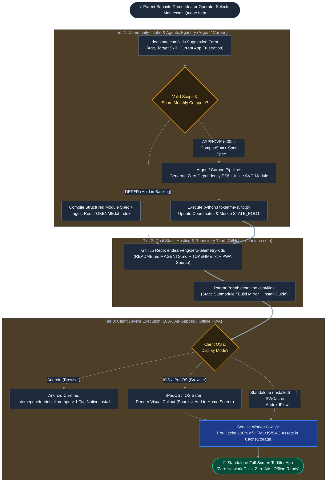

# Zero-Telemetry Kids (`endean-eng/zero-telemetry-kids`)

[](LICENSE.md)
[](LICENSE.md)
[-success.svg)](#3-zero-telemetry--zero-asset-sprawl-architecture)
[](#2-system-topology--agentic-compilation-loop)

> **Preschoolers shouldn't be monetized, tracked, or subjected to variable-ratio dopamine traps.**  
> `zero-telemetry-kids` is a **100% free, 100% offline, zero-network, zero-ad Progressive Web App (PWA)** built specifically for the motor and cognitive ergonomics of 3-to-4-year-olds.

---

## 👨‍👩‍👧‍👦 Quick Launch for Parents (Top 20%)

You do not need to know how to code or use GitHub to put these games on your child's tablet or phone.

### 🚀 [**Click Here to Launch & Install (`deaninno.com/kids`)**](https://deaninno.com/kids)

### Why We Built This for Families
* **100% Free Forever:** No subscriptions, no in-app purchases, and no locked chests.
* **Zero Ads & Zero Tracking:** Completely air-gapped after initial load. No data ever leaves your device.
* **Works Offline (Airplane Mode Ready):** Once saved to your Home Screen, every game works offline on road trips and flights.
* **Calm, Tantrum-Free Design:** Oversized touch targets ($96 \times 96\text{ px}$), palm-rest forgiveness for little hands, zero countdown timers, and zero harsh buzzer sounds.
* **Dual-Corner Parent Gate:** Hold both top corners of the screen for $2\text{ seconds}$ to exit or change settings.

### How to Save for Offline Play (30 Seconds)
1. **On Android Tablets & Phones (Chrome / Edge / Samsung Internet):**
   * Open [**`deaninno.com/kids`**](https://deaninno.com/kids) and tap the **`[📲 Tap Here to Install App for Offline Play]`** banner at the top of the screen.
2. **On iPad & iPhone (Safari):**
   * Open [**`deaninno.com/kids`**](https://deaninno.com/kids) in Safari, tap the **Share** icon `[⍐]`, and select **Add to Home Screen** `[➕]`.

### 💡 Have a Game Idea for Your Child?
Submit a 30-second suggestion on [**`deaninno.com/kids`**](https://deaninno.com/kids) (Child's Age, Target Skill/Theme, and Current App Frustrations). We use our automated engineering foundry to compile community requests directly into new offline mini-games!

---
---

## ⚙️ Systems Engineering Case Study (Bottom 80%)

### Why This Exists: A Live Benchmark in Agentic Pipeline Velocity, Token Thermodynamics, & Human-Factors Ergonomics

Beyond serving as a public civic utility for families, `endean-eng/zero-telemetry-kids` is a **live socio-technical benchmark** maintained by **Elijah N. Dean, BSME (Dean Innovative Design LLC)**. 

It publicly stress-tests the **Repository Context Triad (`README.md`, `AGENTS.md`, `TOKENME.txt`)** across a polyglot, zero-dependency ES6 JavaScript and procedural SVG codebase (`DOMAIN_CODE` + `OPAQUE_ASSET` gating). By driving cold-start architectural discovery cost near zero, our multi-agent coding and auditing pipelines (**Argon / Carbon** and the **Montessori-in-a-Notebook Foundry**) compile, audit, and ship community-requested mini-games in $< 30\text{ minutes}$ using leftover monthly AI subscription quota.

---

### 1. Market Failure Analysis & Expected Value (EV) Architecture

While AI code generation has collapsed the software engineering time for deterministic 2D preschool games to $< 2\text{ hours}$, the Google Play Store imposes severe administrative and compliance drag on apps targeting **Ages 5 & Under**:

* **Personal Developer Account Testing Wall:** Personal Play Console accounts mandate recruiting $\ge 12\text{ human testers}$ to opt in and maintain continuous installation for $14\text{ consecutive days}$ before production access is unlocked.
* **Organization Account Verification Overhead:** Registering via a corporate LLC bypasses the 12-tester wall but requires D-U-N-S verification, corporate identity matching, and $3\text{–}5\text{ business days}$ of administrative processing.
* **"Designed for Families" & COPPA Manual Queue:** Targeting Ages 5 & Under triggers mandatory human review ($3\text{–}7+\text{ days}$ per release), strict binary audits against third-party SDK telemetry (which routinely rejects default Unity builds), a live hosted Privacy Policy URL, IARC content ratings, and Data Safety declarations.
* **Discovery Gatekeeping ("Teacher Approved"):** Without Google's slow internal "Teacher Approved" review badge and paid User Acquisition ($3.00+\text{ per install}$), a free, ad-free app remains buried beneath VC-backed subscription funnels.
* **Rolling Target SDK Maintenance Tax:** Google Play mandates annual Target API Level recompilation every August/November, turning a finished static game into a permanent annual maintenance liability.

#### Expected Value (EV) & Opportunity Cost Comparison

Evaluating distribution paths against an operator opportunity-cost benchmark of $C_{\text{opp}} = 60/\text{hr}$ ($1.00/\text{min}$):

$$C_{\text{total}} = H_{\text{human}} \times C_{\text{opp}} + C_{\text{fees}} + \sum_{y=1}^{N} \left(H_{\text{maint}, y} \times C_{\text{opp}}\right)$$

| Execution Path | Active Human Time ($H_{\text{human}}$) | Initial Opportunity Cost ($\text{@ } 60/\text{hr}$) | Annual Maintenance Cost ($H_{\text{maint}} \times 60$) | Calendar Time to Live | Cross-Platform Reach | Strategic Verdict |
| :--- | :--- | :--- | :--- | :--- | :--- | :--- |
| **Path A: Google Play Store (Personal Account)** | $12\text{–}15\text{ hrs}$ | $720\text{–}900 + 25$ | $120\text{–}180/\text{yr}$ | $3\text{–}4\text{ Weeks}$ (14-day gate) | Android Only | **Rejected:** High bureaucratic drag; $80\%$ non-engineering compliance work. |
| **Path B: Google Play Store (LLC Org Account)** | $10\text{–}14\text{ hrs}$ | $600\text{–}840 + 25$ | $120\text{–}180/\text{yr}$ | $1\text{–}2\text{ Weeks}$ (D-U-N-S + COPPA) | Android Only | **Rejected:** Ongoing annual SDK target maintenance and zero iOS/iPad reach. |
| **Path C: Open-Source PWA (`endean-eng/zero-telemetry-kids`) + `deaninno.com` Mirror** | **$3.0\text{–}4.5\text{ hrs}$** | **$180\text{–}270$** | **$0/\text{yr}$** | **Same Day** | **Android + iPadOS + iOS + Desktop** | **Selected (Optimal ROI):** Zero store gatekeeping, $100\%$ offline execution, dual portfolio/community utility. |

---

### 2. System Topology & Agentic Compilation Loop

The system separates **Engineering Governance & Source Truth** (`endean-eng/zero-telemetry-kids`) from **Parent Discovery & Frictionless Onboarding** (`deaninno.com/kids`), linked via automated static deployment and a zero-backend feature request pipeline.



---

### 3. Zero-Telemetry & "Zero-Asset-Sprawl" Architecture

To allow our multi-agent pipelines to one-shot the base application in $60\text{–}90\text{ minutes}$ and compile future mini-games in $20\text{–}30\text{ minutes}$, the architecture eliminates external binary asset dependencies and third-party `npm` frameworks. All constraints are strictly enforced via `AGENTS.md`:

1. **Zero Network & Telemetry Invariant:**
   * Zero external font CDNs, analytics scripts, ad SDKs, or external API calls.
   * Content Security Policy (CSP) locked in `<meta http-equiv="Content-Security-Policy">` to:
     ```html
     default-src 'self'; script-src 'self'; style-src 'self' 'unsafe-inline'; img-src 'self' data:; connect-src 'self';
     ```
2. **Procedural Inline Vector Graphics (Zero Raster Bloat):**
   * All sprites (tractors, barns, grain bins, geometric shapes, animals, numbers, letters) are rendered via high-contrast inline `<svg>` templates or modular `.svg` files governed by the `TOKENME` `OPAQUE_ASSET` pipeline.
   * Eliminates resolution scaling issues across budget Android tablets and Retina iPads while maintaining instant bounding-box hit detection.
3. **Zero-MP3 Audio Stack (Web Speech API + Web Audio Synthesizer):**
   * **Voice Prompts:** Native offline `window.speechSynthesis` API reads warm, deterministic instructions (*"Put the green triangle in the barn!"*) with playback rate clamped to $0.85\text{–}0.90\times$ for 3-year-old comprehension.
   * **Tactile Sound Effects:** Native `AudioContext` oscillator nodes generate cheerful pentatonic marimba/chime chords on successful drops and gentle low-frequency thuds on misses—zero `.mp3` or `.wav` files required.
4. **3-to-4-Year-Old Motor & Cognitive Ergonomics (Human-Factors Guardrails):**
   * **Oversized Hitboxes:** Minimum touch target size of $96 \times 96\text{ CSS pixels}$ with a $+24\text{ px}$ invisible magnetic snap radius on drop targets.
   * **Palm-Rest Multi-Touch Debouncing:** Toddlers frequently rest the thumb or palm of one hand on the screen bezel while dragging with their index finger. Pointer event handlers track active `pointerId` values independently rather than aborting drag state on secondary touch events.
   * **Zero Failure Punishment:** No countdown timers, no "Game Over" states, and no harsh buzzer noises. Incorrect drops gently bounce back to the staging tray with a calm visual cue.
   * **Dual-Corner Parent Gate:** Exiting to the parent settings/install screen requires holding two opposite top corners simultaneously for $2.0\text{ seconds}$ (preventing accidental toddler exits while avoiding text-based math gates).

---

### 4. Repository Structure & `TOKENME` Dogfooding

Each mini-game lives in an isolated ES6 module (`src/games/<game-slug>.js`) implementing a standardized `mount(containerEl, audioApi, speechApi)` and `unmount()` lifecycle contract, registered in `src/registry.js`, and indexed deterministically in `TOKENME.txt`.

```text
zero-telemetry-kids/
├── README.md                  # Two-tier parent & systems engineering documentation
├── AGENTS.md                  # Hard architectural, CSP, & motor-ergonomic invariants
├── TOKENME.txt                # Declarative v2.1 epistemic index & Merkle STATE_ROOT
├── LICENSE.md                 # Dual MIT (Code) / CC-BY 4.0 (Assets & Specs) license
├── To Do.md                   # Phased implementation roadmap & Montessori seed queue
├── index.html                 # Strict-CSP PWA shell & Dual-Corner Parent Gate
├── manifest.json              # Standalone landscape PWA manifest
├── sw.js                      # 100% pre-cached offline Service Worker
└── src/
    ├── app.js                 # Core launcher, AudioContext synth, & SpeechSynthesis wrapper
    ├── install-helper.js      # OS-aware Android (beforeinstallprompt) & iOS install banner
    ├── registry.js            # Declarative mini-game module registry
    └── games/                 # Self-contained ES6 + inline SVG mini-game modules
```

---

### 5. License & Attribution

This repository is dual-licensed to maximize both software reuse and educational commons stewardship:
* **Source Code (`.js`, `.html`, `.css`, `.json`, `.py`):** Licensed under the **MIT License**.
* **Vector Assets, Pedagogical Specifications, & Documentation (`.svg`, `.md`, `TOKENME.txt`):** Licensed under the **Creative Commons Attribution 4.0 International License (CC-BY 4.0)**.

See [`LICENSE.md`](LICENSE.md) for full details. Built and maintained by **Elijah N. Dean, BSME** ([`endean-eng`](https://github.com/endean-eng) / [Dean Innovative Design LLC](https://deaninno.com)).
